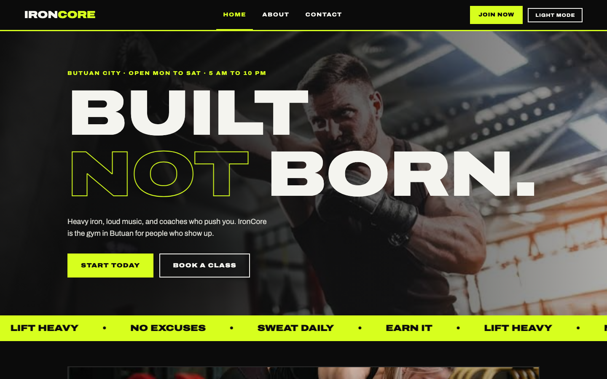
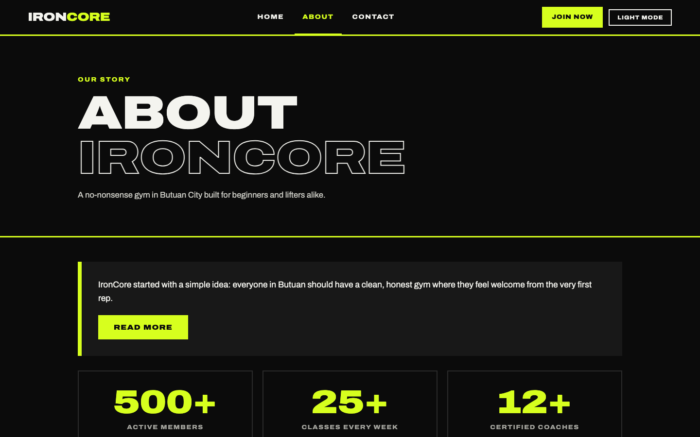
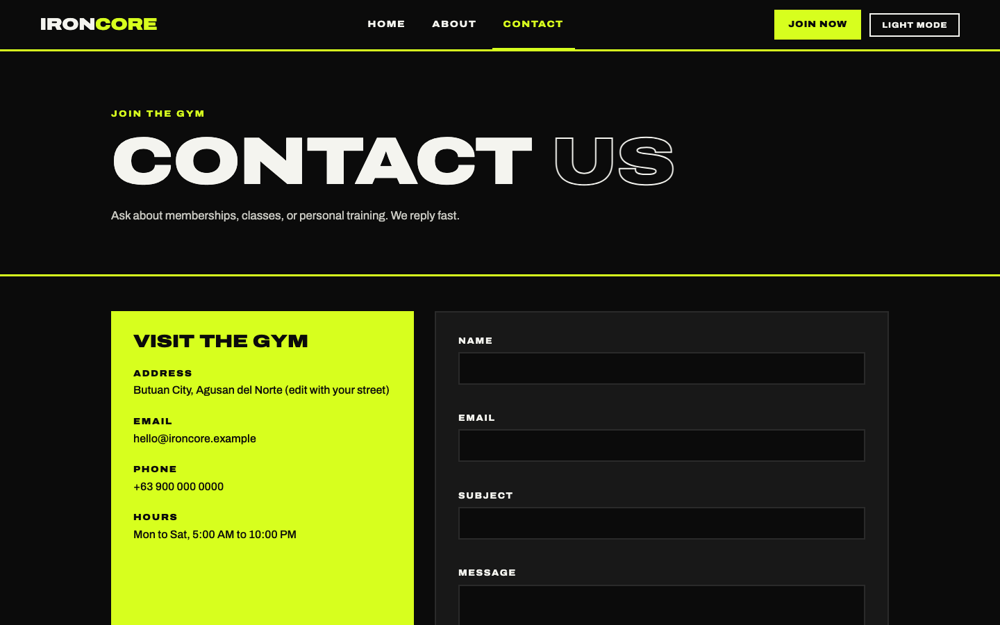

# IronCore Fitness: Laravel Multi-Page Web App

Group name: Lara-Proj-AIBJ2-Hidalgo-Gulle-Lariba
Section:AIBJ2
Members:
- Gillian Hidalgo (Module 1: Layout and Home)
- Lorraine Jade Gulle (Module 2: About)
- Paul Jyrich Lariba (Module 3: Contact)

Each member built their own module on their own branch and pushed it from their own GitHub account.

## Theme
A website for **IronCore Fitness**, a gym in Butuan City: strength floor, group classes you book with credits, membership plans, the gym's story, and a contact form for membership questions. Design: black and acid-lime with stretched, bold Archivo headlines.

## Modules and branches

| Module | Pages / files | Branch | JavaScript feature |
|---|---|---|---|
| Module 1: Layout and Home | `layouts/app.blade.php`, `home.blade.php`, `app.css`, `home.css`, `app.js`, `home.js` | `dev-member1-Hidalgo` | Slide slider (autoplay, arrows, dots), class booking with credits (filters, details, book, saved in localStorage) and light/dark mode toggle |
| Module 2: About | `about.blade.php`, `about.css`, `about.js` | `dev-member2-Gulle` | Read More / Read Less toggle and animated number counters |
| Module 3: Contact | `contact.blade.php`, `contact.css`, `contact.js` | `dev-member3-Lariba` | Client-side form validation with error messages and a success message |

## Screenshots
<!-- Take your own screenshots, save them in a screenshots/ folder, and keep these lines -->

## Steps to run the project
1. Clone the repository: `git clone <repo-url>`
2. Go into the folder: `cd Lara-Proj-AIBJ2-Hidalgo-Lariba-Gulle`
3. Install dependencies: `composer install`
4. Copy the environment file: `cp .env.example .env`
5. Generate the app key: `php artisan key:generate`
6. Create the database tables: `php artisan migrate` (answer "yes" if asked to create the database)
7. Start the server: `php artisan serve`
8. Open http://127.0.0.1:8000 in your browser.

## Project structure (what was added)
- `routes/web.php`: routes for Home, About, Contact
- `resources/views/layouts/app.blade.php`: shared layout with `@yield('content')`, `@stack('styles')`, `@stack('scripts')`
- `resources/views/home.blade.php`, `about.blade.php`, `contact.blade.php`
- `public/css/`: `app.css` (shared), `home.css`, `about.css`, `contact.css`
- `public/js/`: `app.js` (shared dark mode), `home.js`, `about.js`, `contact.js`

## Fonts and images
The font (Archivo, variable width) is saved in `public/fonts/` and loaded with `@font-face`, so it works offline. Photos go in `public/images/` (`hero.jpg`, `slide-*.jpg`, `class-*.jpg`) and are loaded with CSS `url()`. Replace the placeholder pictures with your own or free-license photos (Unsplash, Pexels) and credit them.
